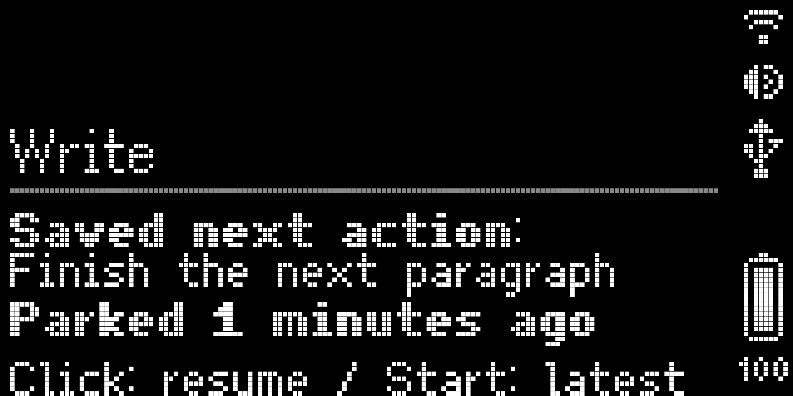

# Backtrack

Bookmark three work contexts with a next action and jump straight back to the latest interruption.

A bookmark includes the exact next action you meant to take. When someone interrupts a review, parking “Check the empty-list case” saves you from reconstructing which part of the pull request you had reached.

## Screen transitions

Watch the selected task change as you park one activity and return to another.


<details>

<summary>Watch the rear display</summary>



</details>

## Park a task when you are interrupted

1. Set the three context names and their next actions in app settings, then restart. The defaults cover building, reviewing and writing.
2. Turn the wheel to the context that is on your desk. Check its next action on the rear display. The recording moves from a parked writing task to **Build**.
3. Click once to park it. The front changes from **FOCUS** to **PARKED** and starts showing how many minutes have passed.


## Return after a second interruption

1. Press **Start** to select the most recently parked context. If you need an older one, turn the wheel instead.
2. Read the saved next action on the rear before resuming. The front clip shows the moment **Build** is parked and its age starts at zero.
3. Click a parked context to resume it and remove that bookmark. Other parked contexts remain available.


## What the bookmark keeps

Each of the three slots stores the name, next action and time together. Suppose you parked **Review** with “Compare the two totals” and later changed that slot’s setting to “Read the next change”. The parked bookmark still contains the first instruction. The new setting applies the next time you park that slot.

The age is reported in whole minutes. Pressing **Start** with no saved bookmarks leaves the current context selected and shows a message on the rear.

## Run in the emulator

Open BUSY Bar Emulator. From this repository, run:

```sh
~/.busy-emulator/bin/busy-emulator dev --once
```

Press **Back** to exit.

The GIFs are excerpts from the emulator recording. Each LED occupies a 16 × 16 cell with a black border. The end frames pause for reading.

[Full recording](media/controls.mp4) · [Rear display](screenshots/back-1.png) · [Firmware test](EMULATOR-QA.md) · [MIT license](LICENSE)

## Device settings

Open **Apps → Backtrack → Setup**. Save the fields and reopen the app to use the new values.

- **Context 1** (`name0`). Default: `Build`.
- **Next action 1** (`next0`). Default: `Run the next test`.
- **Context 2** (`name1`). Default: `Review`.
- **Next action 2** (`next1`). Default: `Read the open change`.
- **Context 3** (`name2`). Default: `Write`.
- **Next action 3** (`next2`). Default: `Finish the next paragraph`.
